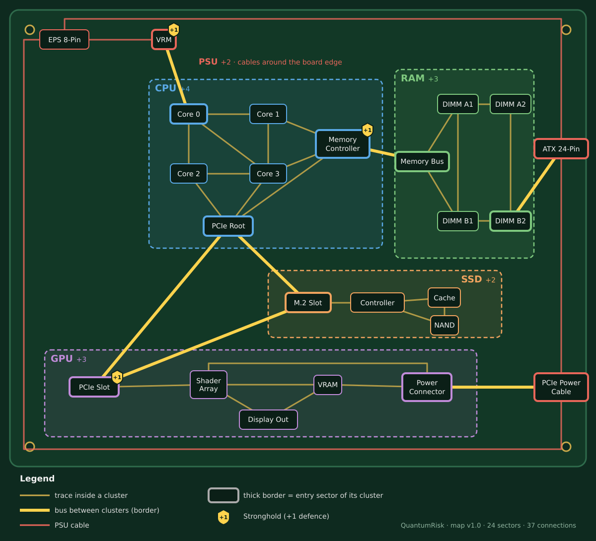

# QuantumRisk — Rulebook

*2–4 players · ~30 minutes*

---

## Contents

1. [Overview: what makes QuantumRisk different](#1-overview)
2. [Components](#2-components)
3. [Setup](#3-setup)
4. [How to win](#4-how-to-win)
5. [Your turn](#5-your-turn)
6. [Combat](#6-combat)
7. [Quantum stacks: superposition and measurement](#7-quantum-stacks)
8. [Cards](#8-cards)
9. [Two-player game](#9-two-player-game)
10. [Quantum Mechanics 101](#10-quantum-mechanics-101)
11. [FAQ](#11-faq)

---

## 1. Overview

QuantumRisk is a game of territorial conquest. On your turn you get reinforcements, attack
neighbouring sectors, and move troops around. Two rules make it different from classic dice-based
conquest games:

1. **Battles are deterministic.** There are no dice. If you attack with more troops than the
   defender has, you win. Everyone can calculate the outcome of every battle in advance.
2. **Quantum stacks are the only uncertainty.** You can send a group of troops into
   **superposition**: it is in sector A *or* sector B, 50/50, and **no one knows which**, including you.
   When an enemy attacks one of those sectors, the stack is **measured**. A quantum circuit
   decides where it actually is, and the battle goes on from there.

So the uncertainty is no longer "how will the dice roll?" It is "are there troops hiding here or
not?" You decide how much uncertainty goes on the board, and where.

## 2. Components

QuantumRisk is a digital game. The game tracks all of the following:

- **The map:** a computer mainboard. Its 24 sectors are connected by circuit traces and grouped
  into 5 clusters, the computer's main components.

  

  | Cluster | Sectors | Cluster bonus |
  |---|---|---|
  | CPU | Core 0, Core 1, Core 2, Core 3, Memory Controller, PCIe Root | +4 |
  | GPU | PCIe Slot, Shader Array, VRAM, Display Out, Power Connector | +3 |
  | RAM | Memory Bus, DIMM A1, DIMM A2, DIMM B1, DIMM B2 | +3 |
  | SSD | M.2 Slot, Controller, Cache, NAND | +2 |
  | PSU | EPS 8-Pin, VRM, ATX 24-Pin, PCIe Power Cable | +3 |

  Connections inside a cluster are called **traces** and connections between clusters are called
  **buses**. The PSU's cables run around the edge of the board. The full list of connections is in
  [`design/map.md`](design/map.md).

- **Troops:** your armies, one colour per player. A sector shows two numbers:
  - **Real troops.** They are definitely there.
  - **Quantum branch** (if any), shown as a translucent "ghost" badge with the size of the
    superposed stack, e.g. `5 + ⟨6?⟩`.
- **Sector cards:** one per sector (24). Each shows a particle: **proton**, **neutron** or
  **electron** (8 of each). There are also 2 **photon** wild cards.
- **Quantum cards:** special-action cards (see [§8](#8-cards)).
- **Mission cards:** secret objectives (see [§4](#4-how-to-win)).
- **Strongholds:** **VRM**, **Memory Controller** and **PCIe Slot**. They give **+1 defence** (see
  [§6.2](#62-resolving-the-battle)).
- **The quantum backend:** every superposition is measured by a quantum circuit run through the
  Moth Quantum platform, either on real quantum hardware or on Moth's quantum emulator. The game log
  shows each measurement result and its source.

## 3. Setup

1. **Choose a mode:** *Missions* (default) or *Global Domination*.
2. **Turn order** is randomized.
3. **Sectors are dealt** randomly and evenly:

   | Players | Sectors each | Starting troops (1st / 2nd / 3rd / 4th player) |
   |---|---|---|
   | 2 (+ neutral) | 8 (neutral gets 8) | 22 / 24 |
   | 3 | 8 | 20 / 21 / 22 |
   | 4 | 6 | 18 each |

   Later players get a few extra troops to make up for moving later.

4. The game puts **1 real troop** on every sector you own. The neutral army puts 2 on each of its sectors.
5. **Place your remaining starting troops.** Players take turns placing them, 3 at a time, on their
   own sectors.
6. In Missions mode each player gets **one secret mission**.
7. Nobody starts with quantum stacks. The first player begins.

## 4. How to win

### Missions mode (default)

You win **as soon as you complete your secret mission**, even in the middle of another player's
turn, e.g. by surviving an attack. If two missions are completed at the same moment, the player
whose turn it is wins. Missions are hidden from the other players.

Mission list:

| # | Mission | Condition |
|---|---|---|
| 1–3 | **Cluster Lord** | Control two specific clusters: CPU + SSD, GPU + PSU, or RAM + SSD (one mission each). |
| 4 | **Expansion** | Control **18** sectors (2 players), **16** (3 players) or **14** (4 players). |
| 5 | **Fortress** | Control 11 sectors with at least 3 real troops on each. |
| 6–9 | **Rival** | Eliminate a specific player colour **yourself**. If that colour is not in the game, is you, or is eliminated by another player, your mission becomes *Expansion*. |

### Global Domination mode

You win when you control every sector that belongs to a player. Neutral sectors don't need to be
conquered. In other words, be the last player standing.

### Elimination

A player who controls no sectors is eliminated. The player who took their last sector **takes all
their cards**.

## 5. Your turn

Every turn has four phases, always in this order:

```
1. REINFORCE  →  2. QUANTUM  →  3. ATTACK  →  4. FORTIFY
   (required)     (optional)     (optional)     (optional)
```

### Phase 1: Reinforce

You get new real troops:

- **Sectors:** the number of sectors you control ÷ 3, rounded down, **minimum 3**.
- **Clusters:** the bonus of every cluster you fully control.
- **Cards:** whatever you trade in (see [§8](#8-cards)). If you start your turn with **5 or more
  cards**, you must trade a set.
- **Owned-sector bonus:** when you trade a set, every card in it that shows a sector you control
  gives **+2 troops placed on that sector**.

Place all of these troops on sectors you control.

### Phase 2: Quantum

Both are optional:

- **Self-measure** one of your own quantum stacks (see [§7.4](#74-self-measurement)), at most once
  per turn.
- **Play Quantum cards** (see [§8.3](#83-quantum-cards)).

### Phase 3: Attack

Attack as often as you like, from any sector that has enough real troops (see [§6](#6-combat)).
If you **conquered at least one sector** this turn, you draw **one sector card** at the end of your turn.

### Phase 4: Fortify

Both are optional, in any order:

- **Move** real troops between your sectors, as many as you like. A move must follow an unbroken
  chain of sectors you control, and every sector must keep **at least 1 real troop**. Quantum
  stacks can't be moved; only real troops can.
- **Split** once: put troops into superposition across two sectors (see [§7.2](#72-splitting)).
  This is how you defend two places at once with the troops you didn't use this turn.

## 6. Combat

### 6.1 Declaring an attack

1. Choose a **source** sector you control and an **adjacent** enemy (or neutral) **target** sector.
2. Choose how many real troops to commit: **N**. Then:
   - N must be **at least 3** (the *minimum attack size*).
   - If the target holds a quantum branch, N must also be **at least the size of that quantum
     stack**. Measuring a big stack costs a big commitment.
   - The source must keep **at least 1 real troop**, so you need at least 4 real troops in a sector
     to attack from it.
   - Only **real** troops can attack. A quantum branch on your source sector doesn't count.
3. If the target holds a quantum branch, it is **measured now** (see [§7.3](#73-measurement)).
4. Count the **defenders D**: the real troops on the target, plus the quantum stack if the
   measurement found it there.

### 6.2 Resolving the battle

| Situation | Result |
|---|---|
| **N > D** (attacker wins) | All defenders are destroyed. The attacker loses **D** troops. The **N − D survivors move into** the conquered sector. You may also move more real troops in from the source (it must keep 1). |
| **N ≤ D** (defender holds) | All N attackers are destroyed. The defender loses **N − 1** troops. |

**Defender's edge:**
- **Ties go to the defender.**
- **Strongholds:** a defending Stronghold sector counts as **D + 1**. The +1 is only a bonus for
  this battle. It isn't a troop and can't be destroyed. Use D + 1 everywhere in the table above,
  so the attacker also loses D + 1 if it wins. When an attack on a Stronghold fails, the defender
  loses only **N − 2** troops instead of N − 1.
  - Example: 6 real troops on a Stronghold count as D = 7. The attacker needs N ≥ 8, and an
    8-troop attack wins, loses 7 and moves 1 in. A 7-troop attack fails: the attacker loses 7,
    and the defender loses 5, so 1 troop remains.

### 6.3 Examples

| Attack | Defence | Result |
|---|---|---|
| 8 | 5 | Attacker wins. Loses 5, moves 3 in. |
| 6 | 5 | Attacker wins. Loses 5, moves 1 in. Expensive! |
| 5 | 5 | Defender holds. Attacker loses 5, defender loses 4 → 1 defender remains. |
| 6 | 10 | Defender holds. Attacker loses 6, defender loses 5 → 5 remain. |

Since there are no dice, you can always calculate a battle against **real** troops exactly.
Uncertainty only appears when a quantum stack might be involved.

## 7. Quantum stacks

### 7.1 What is a quantum stack?

A **quantum stack** is a group of troops in **superposition** across exactly **two** of your
sectors, its **branches**. The stack is **entirely** in one branch or **entirely** in the other,
never split between them, and each branch has a **50% chance**.

A branch sits **on top of** a sector's real troops. A sector must always have at least 1 real troop
to stay yours. A quantum branch alone can never hold a sector.

On the map, a sector with 5 real troops and a branch of a 6-troop stack looks like this:

```
  ┌──────────────┐
  │    CORE 0    │
  │   5  + ⟨6?⟩  │   ← 5 for sure, maybe 6 more
  └──────────────┘
```

If this sector is attacked, there are either **5** or **11** defenders, with a 50/50 chance.

### 7.2 Splitting

Once per turn, in your **Fortify** phase, you may **split**. An Extra Split card allows one more:

1. Choose a **source** sector and how many real troops **S** to put into superposition. The source
   must keep at least 1 real troop.
2. Choose **two different sectors** as branches. Each must be connected to the source by an
   **unbroken chain of sectors you control**. Picture half of the troops heading off one way and half
   the other way. Each branch must also be a sector you control and must **not already hold a
   quantum branch**. The source itself may be one of the branches.
3. The S troops leave the source's real count and become a quantum stack of size S, with one branch
   in each chosen sector.

The game doesn't decide where the stack is. The quantum state is only measured when it has to be.

**You can't** split a quantum stack again, merge stacks, move a stack during Fortify, or attack
with it. To use those troops normally, you have to measure the stack first.

### 7.3 Measurement

A quantum stack is **measured** when:

- an enemy **attacks either of its branch sectors**, or
- its owner **self-measures** it ([§7.4](#74-self-measurement)), or
- an opponent plays a **Forced Measurement** card on it ([§8](#8-cards)).

When a stack is measured:

1. The quantum computer returns **one** result: branch A or branch B, 50/50.
2. The stack **collapses**: all S troops become **real troops** in the sector the result picked.
3. The other branch disappears. It was never there.

Collapse can't be undone. The result is shown to all players.

If the measurement happened because of an attack, the battle is fought with the post-collapse
numbers, as described in [§6.1](#61-declaring-an-attack).

### 7.4 Self-measurement

In your Quantum phase you may measure one of your own stacks, once per turn. You don't get to
choose where it lands; 50/50 still applies. Players usually do this to get the troops back as real
troops, so they can attack with them this turn.

### 7.5 Key facts

- **No peeking.** Nobody knows where a stack is, not even its owner. The result doesn't exist yet.
  It is created at the moment of measurement.
- **Troops are never duplicated.** A 6-stack is worth 6 troops, not 12. It *threatens* two places
  but *defends* only one.
- **Bonuses and ownership come from real troops only.** Cluster bonuses and sector counts don't
  depend on quantum stacks.

## 8. Cards

### 8.1 Getting cards

At the end of any turn in which you conquered at least one sector, draw **one sector card**.
The maximum hand size is 5. At 5 or more cards you must trade at the start of your next Reinforce
phase.

### 8.2 Playing sector cards (Reinforce phase only)

| Play | Requirement | Reward |
|---|---|---|
| **Three of a kind** | 3 × proton, 3 × neutron or 3 × electron | **+4 troops** + **1 Quantum card** |
| **Full atom** | 1 proton + 1 neutron + 1 electron | **+6 troops** + **1 Quantum card** |

A **photon** card is wild and can stand in for any particle. Bonuses are fixed and do **not**
escalate, which keeps games short. Traded cards go back into the deck.

**Owned-sector bonus:** when you trade a set (three of a kind or full atom), every card in it that
shows a sector you control gives **+2 extra troops on that sector**, up to +6 per set. Photon cards
show no sector.

### 8.3 Quantum cards

Quantum cards are kept in hand, and you can hold them on top of the 5-card hand limit. You may play
any number during your Quantum phase, in addition to your self-measurement.

| Card | Effect | Copies |
|---|---|---|
| **Forced Measurement** | Measure any **enemy** quantum stack right now. Plan your attacks after you see the result. | 6 |
| **Extra Split** | Do one extra split in this turn's Fortify phase. | 4 |

## 9. Two-player game

With two players, a third **neutral army** takes part:

- It gets 8 sectors with **2 real troops** each.
- It **never** takes a turn: no reinforcing, attacking, splitting or card draws.
- Neutral sectors are attacked like any other sector.
- Missions that target a colour can't target the neutral army. Global Domination is won by
  eliminating the other player; the neutral army doesn't need to be destroyed.

## 10. Quantum Mechanics 101

*You don't need this section to play, but it explains what's going on, and it's all real physics.*

### Bits and qubits

A normal computer stores information in **bits**. Each bit is either **0** or **1**, like a light
switch that is either off or on.

A quantum computer uses **qubits**. A qubit can be in a **superposition**: a combination of 0 *and*
1 at the same time. It isn't secretly 0 or secretly 1 with the answer hidden somewhere. Before it is
measured, the qubit doesn't have a definite value.

In physics notation, an equal superposition is written like this:

```
|ψ⟩ = (|0⟩ + |1⟩) / √2
```

Read it as "half zero, half one". The √2 makes the probabilities add up to 100%.

### Measurement

When you **measure** a qubit, you get a definite answer: 0 or 1. For the state above, each answer
has a **50%** chance. This is the **Born rule**: the chance of each result is the square of its
weight, here (1/√2)² = ½.

After the measurement the qubit **collapses**. It is now simply 0 (or simply 1), and the
superposition is gone for good. If you measure it again, you get the same answer.

### What QuantumRisk does with this

| In the game | In the quantum computer |
|---|---|
| Your stack is in Core 0 *or* Core 1 | One qubit: `|0⟩` = Core 0, `|1⟩` = Core 1 |
| You split a stack | The qubit is put into equal superposition with a **Hadamard gate (H)** |
| Someone attacks a branch | The qubit is **measured** |
| The stack appears in one sector | The qubit **collapsed** to 0 or 1 |

The circuit is small:

```
|0⟩ ──[ H ]──[ M ]══> 0 = branch A, 1 = branch B
```

The game runs this circuit through the **Moth Quantum platform**, either on real quantum hardware
or on Moth's quantum emulator. The game log tells you which one produced each result.

### "Isn't that just a coin flip?"

That's a fair question. With a single 50/50 qubit, the **statistics** match a fair coin. There are
two differences:

1. **The physics is different.** A coin that has been flipped and hidden already has a result. A
   qubit in superposition doesn't. Its value only comes into being when it is measured.
2. **The randomness comes from a quantum circuit.** On real hardware it is a physical quantum
   process, not a pseudo-random algorithm. The game is honest about where each result came from.

## 11. FAQ

**Can a sector hold branches from two different stacks?**
No. Each sector can hold at most one quantum branch.

**Can I put a branch on an enemy sector?**
No. Both branches must be sectors you control, connected to the source by your own sectors.

**What happens to a branch if the sector's last real troop leaves?**
It can't happen. Every sector must keep at least 1 real troop, and a sector can only be lost to an
attack, which measures the stack first.

**If I conquer a sector after the stack turned out to be elsewhere, does the stack move?**
No. It was "always" in the other branch. It's now real troops in that other sector.

**Do I know my own stack's location?**
No. The result doesn't exist until measurement.

**Can I attack from a sector that holds a branch?**
Yes, but only with its real troops.

**Is the measurement really done on a quantum computer?**
It is done through the Moth Quantum platform, on real quantum hardware or on Moth's quantum
emulator. The log shows which. If the backend is unavailable, the game uses a backup
source and says so in the log.

