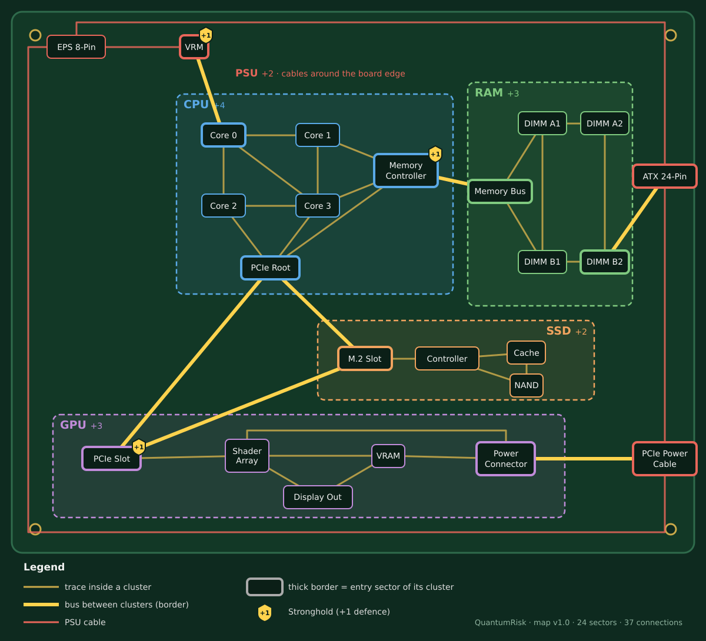

# The Mainboard

*Machine-readable version: [`map.yaml`](map.yaml).*

## Idea

The board is a computer mainboard seen from above, laid out roughly like a real one. The CPU sits
in the middle, RAM to its right, the SSD's M.2 slot below the CPU, and the GPU in the big PCIe slot
at the bottom. The **Power** cluster is different from the other clusters. It isn't one block: its cables run
around the edge of the board and plug in at three places. That makes it small but hard to hold.

**Connections:**
- **Traces** (thin lines) connect sectors inside a cluster.
- **Buses** (thick yellow lines) connect clusters. They are the borders, like the sea lanes and land
  bridges in Risk.
- **Power cables** (dark, with a dashed core) connect the Power cluster's sectors around the board edge.

## Clusters

| Cluster | Sectors | Bonus | Entry sectors | Bus links | Borders | Risk equivalent |
|---|---|---|---|---|---|---|
| **CPU** | 6 | +4 | 3: Core 0, Memory Controller ▲, Root Complex | 4 | Power, RAM, GPU, SSD | Asia/Europe: central, rich, contested |
| **GPU** | 5 | +3 | 2: PCIe x16 ▲, Power Connector | 3 | CPU, SSD, Power | Africa |
| **RAM** | 5 | +3 | 2: Memory Bus, DIMM B2 | 2 | CPU, Power | South America |
| **SSD** | 4 | +2 | 1: M.2 Slot | 2 | CPU, GPU | Australia: a single gate |
| **Power** | 4 | +3 | 3: VRM ▲, ATX 24-Pin, PCIe Power Cable | 3 | CPU, RAM, GPU | Hard to hold, wraps around the board |

▲ = Stronghold (+1 defence)

## Sectors and connections

### CPU (6)

| Sector | What it is | Connects to |
|---|---|---|
| Core 0 | A processor core | Core 1, Core 2, Core 3, **VRM** (Power) |
| Core 1 | A processor core | Core 0, Core 3, Memory Controller |
| Core 2 | A processor core | Core 0, Core 3, Root Complex |
| Core 3 | A processor core | Core 0, Core 1, Core 2, Memory Controller, Root Complex |
| Memory Controller ▲ | Built into the CPU; drives the RAM | Core 1, Core 3, Root Complex, **Memory Bus** (RAM) |
| Root Complex | The CPU's PCIe lanes, feeding the GPU and SSD | Core 2, Core 3, Memory Controller, **PCIe x16** (GPU), **M.2 Slot** (SSD) |

### RAM (5)

| Sector | What it is | Connects to |
|---|---|---|
| Memory Bus | The traces between the CPU and the memory slots | DIMM A1, DIMM B1, **Memory Controller** (CPU) |
| DIMM A1 | Memory slot, channel A | Memory Bus, DIMM A2, DIMM B1 |
| DIMM A2 | Memory slot, channel A | DIMM A1, DIMM B2 |
| DIMM B2 | Memory slot, channel B | DIMM A2, DIMM B1, **ATX 24-Pin** (Power) |
| DIMM B1 | Memory slot, channel B | DIMM A1, DIMM B2, Memory Bus |

### SSD (4)

| Sector | What it is | Connects to |
|---|---|---|
| M.2 Slot | The connector the SSD plugs into; all data passes through it | Flash Controller, **Root Complex** (CPU), **PCIe x16** (GPU) |
| Flash Controller | The SSD's own processor; decides where data goes | M.2 Slot, DRAM Cache, NAND |
| DRAM Cache | Fast buffer where data waits before being written | Flash Controller, NAND |
| NAND | The flash chips where data is actually stored | Flash Controller, DRAM Cache |

### GPU (5)

| Sector | What it is | Connects to |
|---|---|---|
| PCIe x16 ▲ | The graphics card's x16 PCIe link, in a steel-reinforced slot | Shader Array, **Root Complex** (CPU), **M.2 Slot** (SSD) |
| Shader Array | The GPU's thousands of small compute units | PCIe x16, VRAM, Display Out, Power Connector |
| VRAM | The graphics card's own memory | Shader Array, Display Out, Power Connector |
| Display Out | The video outputs for the monitor | Shader Array, VRAM |
| Power Connector | Where the power supply's cable plugs into the card | Shader Array, VRAM, **PCIe Power Cable** (Power) |

### Power (4)

| Sector | What it is | Connects to |
|---|---|---|
| EPS 8-Pin | CPU power cable (top-left corner) | VRM, ATX 24-Pin, PCIe Power Cable |
| VRM ▲ | Voltage regulators next to the CPU, under a heatsink | EPS 8-Pin, **Core 0** (CPU) |
| ATX 24-Pin | Main power connector (right edge, next to the RAM) | EPS 8-Pin, PCIe Power Cable, **DIMM B2** (RAM) |
| PCIe Power Cable | Power cable to the graphics card | EPS 8-Pin, ATX 24-Pin, **Power Connector** (GPU) |

**Totals:** 24 sectors and 37 connections, of which 7 are buses between clusters. That's 3.1
connections per sector on average.

## Design notes

- **The memory controller sits in the CPU,** as on real hardware. The RAM's *Memory Bus* is the
  traces between the CPU and the slots.
- **The CPU borders every other cluster.** It's the most valuable cluster, has three entry sectors,
  and is the hardest to hold. The Memory Controller Stronghold gives a CPU holder some protection.
- **The SSD is the "Australia":** one gate, the M.2 Slot. Unlike Australia, that gate can be attacked
  from two clusters (CPU and GPU), so it's less of a hiding spot.
- **The Power cluster creates loops.** CPU → Power → RAM and CPU → Power → GPU give alternative routes. That
  matters for superposition, because a split can send troops "one way or the other way" around the
  board.
- **Deep sectors:** NAND and DRAM Cache (two steps behind the M.2 Slot) and Display Out (two steps
  behind both GPU entry sectors) are the safest places for reserves.
- **Strongholds are real hardware features:** the VRM is under a heatsink, the Memory Controller
  under the CPU's heat spreader, and the PCIe x16 slot is steel-reinforced.
- **Cluster bonuses** follow the size and the number of entry sectors (see `balance.md`).
- **Sector names are real hardware terms.** The in-game tutorial explains them.
